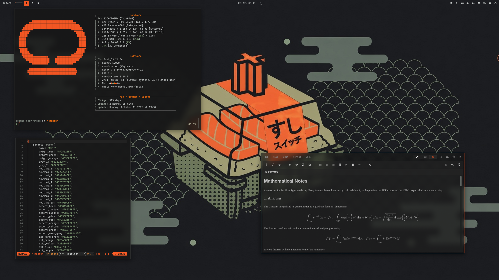

<div align="center">

# Liquid Lambda

Pop!_OS 24.04 on COSMIC, every app themed from one palette file.
Forked from [cosmic-noir-theme](https://github.com/atraxsrc/cosmic-noir-theme).


</div>

> [!NOTE]
> Work in progress. The generator (`palette.toml` → `uv run lambda build`) and
> the palette tuner (`tuner/index.html`) are in; the app themes below are still
> the upstream Noir files and move onto the generator one by one, renamed to
> Lambda as they do.

## Generator

```bash
uv run lambda build     # render every template in templates/ from palette.toml
uv run lambda check     # contrast gates + generated files up to date (pre-commit runs this)
uv run lambda preview --wallpaper    # tuner on the wallpaper COSMIC shows, opened in the browser (tuner/local.html, not committed; --no-open to skip)
uv run lambda preview --wallpaper ~/Pictures/wall.png   # or any image; --output DP-1 picks one screen's wallpaper
```

Open `tuner/index.html` in a browser, move the sliders, press
**Copy palette.toml** and paste the block into `palette.toml`.

---


## Palette

From the Omarchy [Greek Noir](https://github.com/HANCORE-linux/omarchy-greek-noir-theme)
theme: a near-black base, grey-sage neutrals, one loud orange. The accent is
kept as is. Every text colour is at least 4.5:1 on the window background.

| Role | Color | Hex |
|------|-------|-----|
| Background |  Charcoal | `#171717` |
| Containers |  Soot / Slate | `#222222` / `#2A2A2A` |
| Text |  Fog | `#CCD0CF` |
| Accent |  Orange | `#F25623` |
| Warning |  Ember | `#F56E0F` |
| Success |  Sage | `#88A57D` |
| Khaki |  Symlinks, yellow slot | `#AEAB94` |
| Grey-sage |  Directories | `#959C95` |
| Muted |  Secondary text | `#7D837D` |
| Dim |  Comments | `#686C69` |
| Lines |  Box lines, inactive | `#525252` |

Error shares the orange: the upstream palette has no red, and its "red" slot
is khaki. Errors are told apart by bold and underline.

---

## Repo Structure

```
.
├── chromium
│   ├── theme                    # Chromium theme (manifest + icons), Load unpacked
│   └── README.md
├── btop
│   └── Lambda.theme             # btop colour theme (generated)
├── claude-desktop
│   ├── cosmic-noir.jsonc        # Claude Desktop theme (claude-desktop-extra), dark + light
│   └── install.sh
├── cosmic
│   ├── Lambda.ron               # COSMIC Appearance import (Dark, generated)
│   ├── config/                  # baseline settings: fonts, icons, terminal look
│   └── install.sh
├── cosmic-term
│   ├── Noir-term.ron            # COSMIC Terminal colour scheme
│   ├── Noir-term-*.ron          # dimmer plain-text variants, same ANSI colours
│   └── README.md                # previews and which one to pick
├── cursors
│   ├── Oxygen-Noir-*/            # cursor themes, one per icon colour, patched for COSMIC apps
│   ├── recolour.py              # makes a variant from any other, see cursors/README.md
│   ├── install.sh
│   ├── uninstall.sh
│   └── README.md
├── icons
│   └── install.sh               # Cosmic-Noir icon pack from cosmic-icon-themes
├── fastfetch
│   ├── config.jsonc             # fastfetch config (generated)
│   └── cosmic.txt               # COSMIC logo
├── firefox
│   ├── theme                    # Cosmic Noir theme add-on (manifest + icons)
│   ├── chrome
│   │   ├── userChrome.css       # rounded chrome, soot menus
│   │   └── userContent.css      # new tab accent
│   ├── install.sh
│   └── README.md
├── lsd
│   ├── config.yaml              # theme: custom
│   ├── colors.yaml              # permission / size / date / git columns
│   └── install.sh
├── nvim                         # Neovim colorscheme, LazyVim spec, RON syntax, install.sh
├── telegram
│   ├── colors.tdesktop-theme    # Telegram Desktop colour scheme (source)
│   ├── cosmic-noir.tdesktop-theme  # built theme, open this in Telegram
│   └── build.sh                 # rebuilds it, optionally with a wallpaper
├── vscode
│   ├── themes/                  # Cursor / VS Code colour theme, Noir
│   ├── package.json             # extension manifest
│   ├── install.sh               # packs a .vsix, installs it with cursor --install-extension
│   └── README.md
├── scripts
│   └── update_system.sh         # nala + flatpak, orange / sage ANSI
├── zsh
│   ├── lambda.zsh               # LS_COLORS, highlighting colours (generated)
│   └── aliases.zsh              # optional aliases + starship init
├── wezterm/Lambda.toml          # WezTerm colour scheme (generated)
├── starship/palette.toml        # Starship palette (generated)
├── prismantis/lambda.json       # prismantis colour slots (generated)
├── assets
│   ├── cursors/                 # cursor preview
│   ├── cosmic-term/             # scheme previews for cosmic-term/README.md
│   └── screenshot.png           # README screenshot (upstream Noir, replaced later)
├── liquid_lambda/               # the generator: colour maths, palette roles, renderer, CLI
├── templates/                   # <path>.j2 renders to <path>; tuner/engine.js mirrors the palette maths
├── tuner/index.html             # generated palette tuner
├── tests/                       # pytest, incl. JS/Python engine parity
├── palette.toml                 # the inputs every colour comes from
├── pyproject.toml
├── LICENSE
└── README.md
```

---

## COSMIC Desktop

Settings → Desktop → Appearance → **Dark** → **Import** → `cosmic/Lambda.ron` (generated; `lambda apply` prints the path)

Accent is the palette lead colour. Use the `+` control if you want a custom swatch.

Frosted glass is on in the `.ron` at `frosted: Low` with an opacity table of
0.66 to 0.96, tinted with the palette's middle neutral, for windows, panel,
applets and system UI (maximized apps stay solid), and corners are squared
(`radius_*: 2.0`), the same as the DarkGold baseline. Adjust frosted glass on
Appearance → Style → Frosted glass after import; those sliders survive a theme switch.

Export from Appearance if you tweak backgrounds / tints so you do not lose them.

### Baseline settings

`cosmic/config/` holds the settings that make up the look and rarely change
(panel, dock, applets and shortcuts are left out on purpose):

| Where | Setting |
|-------|---------|
| Fonts | Interface `Maple Mono Normal` Light, monospace `Maple Mono Normal NFM` |
| Icons | Cosmic-Noir-Orange |
| Windows | Minimize / maximize buttons hidden, theme applied to GNOME apps |
| Terminal | Maple Mono 15 (weights 500 / bold 800 / dim 300), 77% opacity, no header bar, Noir |

Install the [Maple fonts](https://github.com/subframe7536/maple-font/releases)
(Maple Mono Normal and Maple Mono Normal NFM) and the Cosmic-Noir icons (see
Icons below) and import the terminal scheme first, then:

```bash
./cosmic/install.sh
```

It backs up each file it replaces to `*.bak` and COSMIC applies it live.

The interface font is the Light weight on purpose. COSMIC sets interface text
brightness itself (the text tint only picks the hue), so on these dark panels
labels land near `#DFE7DF` whatever tint you choose; the thinner strokes are
what calms them at night. Settings → Fonts lists only families, so the weight
lives in `cosmic/config/com.system76.CosmicTk/v1/interface_font`.

---

## COSMIC Terminal

The desktop `.ron` does not colour ANSI text.

1. COSMIC Terminal → **View → Color schemes…** (not Settings → Appearance)
2. Dark tab → **Import** → `cosmic-term/Noir-term.ron`
3. View → Settings → Appearance → Color scheme (dark) → **Noir**

If a profile is set as default, set the scheme on that profile too or the
dropdown will look like it did nothing.

Fog text on charcoal; orange for errors and the cursor, sage for strings and
success, khaki in the yellow slot, grey-sage for directories.

If fog glares at night, there are five dimmer variants with the same ANSI
colours, from Smoke `#7D837D` up to Pale `#BCBFBC`. Previews and which to
pick: [`cosmic-term/README.md`](cosmic-term/README.md).

---

## Firefox

Two layers:

1. **Theme (colours):** install
   **[cosmic-noir-theme on addons.mozilla.org](https://addons.mozilla.org/en-US/firefox/addon/cosmic-noir-theme/)**.
   This is the main look.
2. **Stylesheets (optional):** `firefox/chrome/` adds rounded corners, orange
   menu hover, orange accents and blank new-tab tiles on top of the add-on
   (they also work with Firefox's built-in Dark theme):

```bash
./firefox/install.sh
```

Fully quit Firefox afterward. Details and CSS rules: [`firefox/README.md`](firefox/README.md).

---

## Chromium (Brave, Chrome)

`chromium/theme` is a Chromium theme from the palette: charcoal frame, toolbar
in the first surface, cyan active tab text and new-tab links. Brave, Chrome,
Chromium and Edge take it, loaded straight from the clone, so no Chrome Web
Store or Google account is needed:

`chrome://extensions` (or `brave://extensions`) → **Developer mode** → **Load unpacked** → `chromium/theme`

Leave the clone in place, the browser keeps reading the folder; after a
`lambda build`, press the reload arrow on the theme's card. Colours, limits and
packing a `.crx`: [`chromium/README.md`](chromium/README.md).

## Claude Desktop

For the unofficial [claude-desktop-extra](https://github.com/patrickjaja/claude-desktop-extra)
Linux build. `claude-desktop/cosmic-noir.jsonc` is one theme with both halves:
Noir in dark mode and Dossier in light mode, so Claude's own
Settings → Appearance toggle switches between the two rices.
Colours come from `cosmic/*.ron`, contrast-checked (text and button text
4.5:1, accents 3:1).

```bash
./claude-desktop/install.sh
```

It copies the file into `~/.config/Claude/themes.d/`. Then press
<kbd>Ctrl</kbd>+<kbd>Shift</kbd>+<kbd>T</kbd> in Claude Desktop and pick **cosmic-noir**.

The same file ships in [`cosmic-dossier-theme`](https://github.com/atraxsrc/cosmic-dossier-theme),
so installing from either repo gives the same theme.

---

## Cursor editor

`vscode/` is a colour theme extension for [Cursor](https://cursor.com):
**Cosmic Noir**. It is a plain VS Code theme extension, so VS Code and VSCodium
take it too. Code is coloured the way Neovim is in the rice; the workbench is charcoal with soot menus, hovers and inputs,
orange on the active tab, buttons and menu highlight, and the integrated
terminal uses the COSMIC Terminal scheme. Cursor builds its Agent and chat
panels from the same theme colours, so they follow along.

```bash
./vscode/install.sh
```

It packs `vscode/` into a `.vsix` and installs it with
`cursor --install-extension`; run it again after editing the theme. Then press
<kbd>Ctrl</kbd>+<kbd>K</kbd> <kbd>Ctrl</kbd>+<kbd>T</kbd> in Cursor and pick
**Cosmic Noir**. The colours and the contrast notes are in
[`vscode/README.md`](vscode/README.md).

---

## Telegram

`telegram/cosmic-noir.tdesktop-theme` is a Telegram Desktop theme: charcoal
chat list and background, soot incoming and dark-sage outgoing bubbles, orange
for the accent, links, unread badges and buttons (with charcoal text on them),
sage for online status and read ticks. Group member names cycle through eight
of the rice's colours: orange, sage, khaki, grey-sage, pale khaki, amber, light
sage and ember. Text and badge colours are contrast-checked at 4.5:1 or better,
except disabled menu items.

Settings → Chat Settings → Chat wallpaper → **Choose from file** →
`telegram/cosmic-noir.tdesktop-theme` → **Apply this theme**.

The colours live in `telegram/colors.tdesktop-theme`, which is plain text;
`build.sh` zips it with the chat background into the `.tdesktop-theme`. The
background is plain charcoal; to put a wallpaper behind the chat instead
(ImageMagick re-encodes it to a 2560px JPEG, Telegram caps theme files at 5 MB):

```bash
./telegram/build.sh --wallpaper ~/Pictures/wall.png
```

Built against Telegram Desktop 7.3.1. Calls, group calls, statistics charts and
premium badges keep Telegram's own colours.


---

## Cursor

**Oxygen** cursors recoloured to the icon colours, one per folder colour of the
Cosmic-Noir icon pack: **Orange** (default), **Sage**, **Dark**. Patched with the cursor
names COSMIC apps ask for. COSMIC has no cursor picker yet, so the script sets it:

```bash
./cursors/install.sh                      # Orange
./cursors/install.sh --variant Sage      # or another, see --list
reboot
```

Previews, what the script touches, how to undo it and how the colours are made:
[`cursors/README.md`](cursors/README.md).

---

## Scripts

### `update_system.sh`

nala + flatpak updater. Headers in orange, info in grey-sage, success in sage,
errors in orange; the banner ramps from sage to fog, orange only in the rule below it.

```bash
chmod +x scripts/update_system.sh
./scripts/update_system.sh
```

## Terminal extras

Need a [Nerd Font](https://www.nerdfonts.com/) in the terminal for the icons
(Maple Mono NFM in the baseline above).

### zsh

`zsh/lambda.zsh` (generated) holds the shell colours: `LS_COLORS` (also used by
lsd for file names and by the completion menu) and the zsh-autosuggestions /
zsh-syntax-highlighting styles. `lambda apply --only zsh` sources it from
`~/.zshrc.local` when that exists (a file dotfile managers usually leave alone),
otherwise from `~/.zshrc`, inside a marked block.

`zsh/aliases.zsh` keeps upstream's optional lsd / bat / nvim aliases and the
starship init; source it yourself if you want them.

### lsd

File names are coloured by `LS_COLORS` from `zsh/lambda.zsh`;
`lsd/colors.yaml` colours the other columns with the 256-colour codes nearest
the palette (202 orange, 208 ember, 108 sage, 144 khaki, 246 grey-sage,
243 muted, 240 dim). lsd 1.0.0 does not accept `#hex` there.

```bash
./lsd/install.sh
lsd -l
```

### fastfetch

COSMIC logo in the lead colour, Hardware / Software / Age boxes in the line
colour, section titles in the second colour. `lambda apply --only fastfetch`
links `fastfetch/config.jsonc` and `fastfetch/cosmic.txt` into
`~/.config/fastfetch/`.

### Neovim

`nvim/` carries the rice into Neovim: a dependency-free colorscheme built from
the palette (`nvim/colors/noir.lua`), a LazyVim spec that selects it and makes
sure the treesitter parsers for the files in this repo are installed
(`nvim/lua/plugins/noir.lua`), and a small RON syntax file so `cosmic/*.ron`
is coloured even before the parser exists. `:terminal` inside Neovim uses the
Noir scheme.

```bash
./nvim/install.sh
# restart nvim; LazyVim switches to the noir colorscheme
```

Without LazyVim, copy `nvim/colors/noir.lua` to `~/.config/nvim/colors/` and
run `:colorscheme noir`.

### btop

`btop/Lambda.theme` (generated): meters run from the cyan rim through the amber
core to the error red. `lambda apply --only btop` links it into
`~/.config/btop/themes/` and sets `color_theme = "Lambda"` in `btop.conf`
(quit btop first, it rewrites the file on exit).

### WezTerm

`wezterm/Lambda.toml` (generated) is a WezTerm colour scheme with the 16 ANSI
colours, cursor, selection and tab bar. `lambda apply --only wezterm` links it
into `~/.config/wezterm/colors/`; select it in `wezterm.lua`:

```lua
config.color_scheme = 'Lambda'
```

Anything under `config.colors` still overrides single colours of the scheme.

### Starship

`starship/palette.toml` (generated) is a `[palettes.lambda]` table that also
overrides the standard colour names, so styles like `bold cyan` come out in
the palette in any terminal. `lambda apply --only starship` adds it and
`palette = "lambda"` to `~/.config/starship.toml` between
`# >>> liquid-lambda` markers, and refuses when the file already selects
another palette.

### prismantis (Claude Code)

`prismantis/lambda.json` (generated) holds the 22 colour slots of the
[prismantis](https://github.com/NahumLitvin/prismantis) Claude Code plugin.
`lambda apply --only prismantis` merges them into
`pluginConfigs["prismantis@prismantis"].options` in `~/.claude/settings.json`;
run `/reload` in open sessions. The terminal scheme and prismantis come from
the same palette, so Claude Code's truecolor text and the ANSI colours of the
statusline and tools agree.

# btop → Esc → Options → Color theme → Noir
```

---

## Icons and wallpaper

Icons: **Cosmic-Noir**, the [Kanagawa icons](https://github.com/Fausto-Korpsvart/Kanagawa-GKT-Theme/tree/main/icons/Kanagawa)
by Fausto Korpsvart recolored to this palette in
[cosmic-icon-themes](https://github.com/atraxsrc/cosmic-icon-themes). Folders come in
three colors: **Orange** `#F25623` (default), **Sage** `#88A57D` and **Dark** `#2A2A2A` with orange symbols.


```bash
./icons/install.sh                 # Orange folders
./icons/install.sh --variant Sage  # or Dark
```

It downloads the pack from the latest cosmic-icon-themes release, checks its SHA256,
installs it to `~/.local/share/icons/` and sets it as the COSMIC icon theme.
Restart open apps afterwards (Files caches icons per window).
Add `--system` to install to `/usr/share/icons` instead, for every user and the
login screen (asks for sudo); `--user` is the default.

---

## Setup

```bash
git clone https://github.com/atraxsrc/cosmic-noir-theme.git
cd cosmic-noir-theme

# desktop
# Settings → Appearance → Dark → Import cosmic/Lambda.ron

# terminal
# View → Color schemes → Import cosmic-term/Noir-term.ron

# firefox add-on
# https://addons.mozilla.org/en-US/firefox/addon/cosmic-noir-theme/

# optional extra chrome
./firefox/install.sh

# chromium: chrome://extensions → Developer mode → Load unpacked → chromium/theme

# claude desktop (claude-desktop-extra), then Ctrl+Shift+T
./claude-desktop/install.sh

# cursor editor, then Ctrl+K Ctrl+T → Cosmic Noir
./vscode/install.sh

# telegram desktop
# Settings → Chat Settings → Chat wallpaper → Choose from file → telegram/cosmic-noir.tdesktop-theme

# cursor (then reboot), see cursors/README.md
./cursors/install.sh                      # Orange
./cursors/install.sh --variant Sage      # or another, see --list
reboot

# shell + terminal tools (see Terminal extras above)
uv run lambda apply   # zsh, fastfetch, btop, WezTerm, Starship, prismantis
./lsd/install.sh
./nvim/install.sh

./icons/install.sh                  # icons (see Icons above)
# Maple fonts (https://github.com/subframe7536/maple-font), then
# fonts, icons, terminal look from cosmic/config/
./cosmic/install.sh
```

---

## Applying

```bash
uv run lambda apply            # build, then install every target
uv run lambda apply --dry-run  # show what would change
uv run lambda apply --only wezterm,starship
```

Whole generated files are symlinked, so a later `lambda build` updates them
without another apply. Files you own get a marked block or only our keys, after
a timestamped backup (`*.bak-YYYYmmdd-HHMMSS`). When chezmoi manages one of
them, apply says so: keep the change with `chezmoi re-add <file>`. Steps it
cannot do itself are listed at the end.

## Stack

| Tool | What it does |
|------|-------------|
| [Pop!_OS 24.04](https://pop.system76.com/) | Base OS by System76 |
| [COSMIC DE](https://system76.com/cosmic) | Desktop environment |
| [oh-my-zsh](https://ohmyz.sh/) | zsh framework + plugins |
| [lsd](https://github.com/lsd-rs/lsd) | `ls` with icons and colours |
| [fastfetch](https://github.com/fastfetch-cli/fastfetch) | System info |
| [btop](https://github.com/aristocratos/btop) | Resource monitor |
| [cosmic-icon-themes](https://github.com/atraxsrc/cosmic-icon-themes) | Icon pack (Cosmic-Noir), recolored from [Kanagawa icons](https://github.com/Fausto-Korpsvart/Kanagawa-GKT-Theme/tree/main/icons/Kanagawa) |
| [Oxygen-Cursors](https://github.com/wo2ni/Oxygen-Cursors) | Cursor, recoloured to the icon colours |

## Credits

- Fork of [cosmic-noir-theme](https://github.com/atraxsrc/cosmic-noir-theme) by atraxsrc (MIT),
  itself a COSMIC port of [omarchy-greek-noir-theme](https://github.com/HANCORE-linux/omarchy-greek-noir-theme)
  by HANCORE-linux (MIT).
- Shared baseline (frosted glass, squared corners, fonts) from
  [cosmic-darkgold-theme](https://github.com/atraxsrc/cosmic-darkgold-theme).

## License

MIT. The cursor artwork keeps the terms of KDE's Oxygen project, see
[`cursors/README.md`](cursors/README.md).
